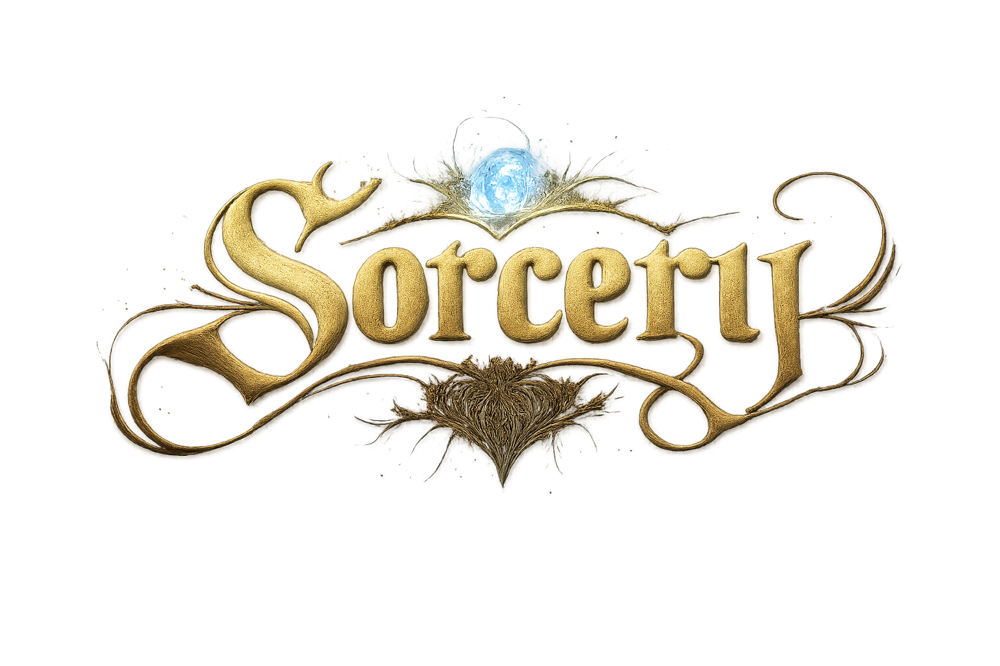

<p align="center">

  
</p>

<h3 align="center">Compress intent into test-bound spells.<br>Enforce correctness with executable evidence.</h3>

<p align="center">
  <em>A notation for transmitting architectural wisdom with perfect gates.</em>
</p>

<p align="center">
  <a href="#the-problem">The Problem</a> •
  <a href="#the-solution">The Solution</a> •
  <a href="#quick-start">Quick Start</a> •
  <a href="#how-it-works">How It Works</a> •
  <a href="#examples">Examples</a> •
  <a href="#get-started">Get Started</a>
</p>

---

> **Note:** Sorcery is a *design doctrine* for enforceable architecture handoff—not a framework, language, or product. It binds intent to tests so it survives transmission with evidence. Spells are complete only with executable tests; semantic inference is deprecated.

---

### 💝 Support Sorcery

🚀 **If Sorcery helps you, consider [sponsoring](https://github.com/sponsors/Michael-A-Kuykendall) — 100% of support goes to keeping it free forever.**

- **$5/month**: Coffee Hero ☕ — Eternal gratitude + name in [SPONSORS.md](SPONSORS.md)
- **$25/month**: Developer Supporter 🐛 — Priority bug response + roadmap influence
- **$100/month**: Corporate Backer 🏢 — Logo in README + release-note recognition
- **$500/month**: Enterprise Partner 🚀 — Prominent logo + monthly office hours + roadmap input

[**🎯 Become a Sponsor**](https://github.com/sponsors/Michael-A-Kuykendall) | See our amazing [sponsors](SPONSORS.md) 🙏


---

## ⚡ The Problem

You've mapped the territory. You understand the tradeoffs. The architecture lives in your head, fully formed.

Then you hand it off—and watch it dissolve:

- ◆ Agents hallucinate where you were precise
- ◆ Apprentices miss the constraints you thought were obvious  
- ◆ Future-you inherits a codebase with no memory of why

**Intent evaporates at the boundary.** Deep constraints, non-obvious tradeoffs, and hard-won decisions vanish into narrative fog.

**Context is the scarcest resource in software.** And handoff destroys it.

---

## ✦ The Solution

**Sorcery** is a notation for binding intent into enforceable, transmissible form.

- **Cast:** Compress high-context reasoning into a test-bound spell—terse, complete, with executable obligations
- **Invoke:** Expand the spell into code + tests, verified by runtime evidence

Think of it as enchanting your architecture with perfect gates so it can be wielded flawlessly.

**The core idea:** *Sorcery casts high-context intent into constrained spells so lower-context agents can act correctly without shared memory.*

### A Note on Context Asymmetry

Sorcery is intentionally **downward-facing**: casting spells is a high-context planning task; invocation is a low-context execution task.

In practice, most failures show up when spells describe things loosely instead of enumerating dependencies with `>`. What isn't listed as a dependency doesn't exist.
See `examples/LESSONS_CONTEXT_ASYMMETRY.md`.

---

## ✧ Quick Start

Here is a spell that binds a tokenizer's contract:

```glyph
#Spell: Tokenize
^ Intent: produce stable, cross-platform tokens for deterministic inference

@Tokenizer
  : utf8 -> tokens
  $ require: fn tokenize
  $ forbid: network
  $ forbid: persistence
  $ prove: deterministic -> test: det
  $ prove: locale_free -> test: locale
  ~ valid_utf8
```

**This isn't code—it's bound intent.** It declares what must hold, what is forbidden, and why—so any agent can invoke it without improvisation.

---

## ⚗️ How It Works

### The Core Asymmetry

Sorcery enforces a clean separation between those who encode intent and those who execute it:

| Phase | Who | What Happens |
|-------|-----|--------------|
| **Casting** | The architect | Bind reasoning into a spell |
| **Invocation** | Agents, apprentices | Expand the spell into artifacts |

**Casting destroys excess context.**  
**Invocation never invents missing intent.**

### Spells: Atomic Units of Intent

A **Spell** is one focused capability, bound tight with test evidence:

- **Intent** — The "why" that survives all tradeoffs
- **Obligations** — Require (existence), Forbid (prohibition), Prove (test-evidence)
- **Assumptions** — What the spell relies upon

Every spell does **exactly one thing**. Obligations ensure completeness; tests provide proof.

### Glyph: The Shorthand Language

**Glyph** is Sorcery's symbolic notation—designed for human readability and test binding:

| Symbol | Meaning | Example |
|:------:|---------|---------|
| `#` | Spell name | `#Spell: Tokenize` |
| `^` | Intent (required!) | `^ produce stable tokens` |
| `@` | Component/Entity | `@Tokenizer` |
| `:` | Input → Output | `: utf8 -> tokens` |
| `$` | Obligation (require/forbid/prove) | `$ prove: deterministic -> test: det` |
| `~` | Assumption | `~ valid_utf8` |
| `>` | Dependency | `> @Tokenizer` |
| `?` | Open question | `? performance reqs` |

**Note on `?`:** Open questions block the entire casting process—resolve them *before* producing a sealed spellbook, not after.

**Why symbols?** Prose is ambiguous. Glyphs enforce structure. Tests provide executable verification.

### Slice Gating: The Seal of Completion

A spell cannot be invoked until it is **sealed**:

- ◆ Intent declared
- ◆ No open questions (`?`) remain
- ◆ Obligations complete (require/forbid/prove with tests)
- ◆ Does exactly one thing

**A malformed spell cannot be cast.** This is quality by constraint.

### Cleanup Rule: De-Sorcery Before Delivery

Spells may use Sorcery shorthand during planning, but shipped artifacts must not.

- Keep Sorcery words in planning docs only.
- Production specs should exclude them (e.g. `- sorcery_terms_in_artifacts`).
- Invocations must be neutral; tests enforce Sorcery obligations.

### Test-Bound Verification

Spells bind obligations to executable tests. Verification happens at runtime:

- `$ require:` obligations ensure functions/components exist
- `$ forbid:` obligations prevent prohibited patterns (enforced by tests)
- `$ prove:` obligations bind to specific test cases

**No separate verification tool needed** - tests provide complete enforcement.

---

## ◈ Examples

### Basic Spell: Tokenization

```glyph
#Spell: Tokenize
^ Intent: produce stable, cross-platform tokens to enable deterministic inference and caching

@Tokenizer
  : utf8 -> tokens
  $ require: fn tokenize
  $ forbid: network
  $ forbid: persistence
  $ prove: deterministic -> test: det
  $ prove: locale_free -> test: locale
  ~ valid_utf8
```

**What it binds:**
- ◆ What it does (utf8 → tokens)
- ◆ Why it exists (deterministic inference)
- ◆ What must hold (require/forbid/prove with tests)
- ◆ What it assumes (valid utf8)

### Composed Spells: Building Systems

```glyph
#Spell: Parse
^ Intent: build stable syntax tree for semantic analysis

@Parser
  : tokens -> ast
  > @Tokenizer  # depends on Tokenize spell
  $ require: fn parse
  $ forbid: io
  $ prove: no_side_effects -> test: side_effects
  ~ valid_token_stream
```

Spells compose through **explicit contracts**—no hidden dependencies, no implied knowledge.

**Note on execution order:** The `>` dependency graph defines implementation order. Start with spells that have no dependencies, then proceed to those whose dependencies are satisfied. Do not ask "what's next?"—the DAG tells you.

### Advanced: Multi-Entity Spell

```glyph
#Spell: InferenceABI
^ Intent: define stable contract boundary for model inference that survives version changes

@InferenceEndpoint
  : request -> response
  $ require: fn endpoint
  $ forbid: streaming
  $ prove: version_tagged -> test: version
  $ prove: backward_compatible -> test: backward
  ~ authenticated_caller

@RequestSchema
  : json -> validated_input
  $ require: fn validate_request
  $ forbid: unknown_fields
  $ prove: schema_versioned -> test: schema_version

@ResponseSchema
  : inference_result -> json
  $ require: fn serialize_response
  $ forbid: stack_traces
  $ prove: deterministic_serialization -> test: det_serialization
```

**See the full examples in** [`examples/`](examples/)

### Provenance (Examples vs Doctrine)

The case studies in `examples/` were largely produced around commit `d114aee`.

A later doctrine clarification tightened `>` to mean dependency (requires) and added a small dependency-pattern primer at commit `7182854`.

If you are reproducing results or writing new spells, use the current doctrine; treat older examples as historical artifacts of the experiment timeline.

---

## ⚔️ Why This Works

### Negative Space Matters

**What you forbid is as important as what you allow.**

Forbids are first-class. A spell without them is probably incomplete.

### Boundary with Testing

| Layer | Job |
|-------|-----|
| **Sorcery** | Defines *what must be true* |
| **Tests** | Ensures *it stays true* |

Spells drive tests. Tests don't define spells.

### The Philosophy

```
Compression     over  Verbosity
Constraints     over  Explanation
Interfaces      over  Narrative
Explicit forbid over  Implied scope
Artifacts       over  Memory
```

**The canonical rule:** *Write spells that declare exactly what must happen and what must never happen—so any agent can invoke them without guessing.*

---

## 🔮 The Grammar is Complete

Nine symbols. No more needed.

Every architectural concept—wrapper metadata, optional behaviors, library variants, language semantics, regex precision—maps to existing glyphs. The temptation to add new symbols is a sign you haven't found the right incantation yet.

### ◆ Symbols vs. Vocabulary

```
Symbols      = Grammar   (fixed, nine total)
Values       = Vocabulary (infinite, domain-specific)
Incantations = Sentences  (grammar + vocabulary combined)
```

English doesn't add new grammar to express new ideas. It combines existing grammar with new vocabulary. Sorcery works the same way.

### ◆ The Incantation Table

| Concept | Symbol | Example |
|---------|--------|---------|
| Function/component must exist | `$ require:` | `$ require: fn tokenize` |
| Behavior must be forbidden | `$ forbid:` | `$ forbid: network` |
| Behavior must be proven with test | `$ prove:` | `$ prove: deterministic -> test: det` |
| Optional enhancement | `@` | Separate `@Extension` component |
| Library variant | `>` | `@ES6Equal > @Equal` |
| Runtime assumption | `~` | `~ valid_utf8` |

### ◆ Incantation Patterns

**Preserving identity through wrappers:**
```glyph
@Wrapper
  $ prove: preserves_function_name -> test: name_preserved
  $ prove: preserves_function_length -> test: length_preserved
  $ forbid: exposes_internal_state
```

**Separating core from optional:**
```glyph
@Core
  : fn -> wrapped_fn
  $ prove: executes_once -> test: once_execution

@Extension
  > @Core
  $ prove: adds_prototype_method -> test: prototype_added
  $ forbid: auto_installed
```

**Expressing variants:**
```glyph
@Equal
  : (a, b) -> boolean
  $ prove: handles_objects -> test: object_handling
  $ forbid: handles_Map

@ES6Equal
  > @Equal
  $ prove: handles_Map -> test: map_handling
  $ prove: handles_Set -> test: set_handling
```

**Declaring runtime assumptions:**
```glyph
@SetCompare
  : (a, b) -> boolean
  ~ set_uses_reference_equality
  ~ objects_not_deep_compared_inside_sets
```

### ◆ Finding the Right Incantation

When a concept seems inexpressible, ask:

| Question | Symbol |
|----------|--------|
| Must this function/component exist? | `$ require:` |
| Must this behavior be forbidden? | `$ forbid:` |
| Must this behavior be proven with test? | `$ prove:` |
| Do we rely on this being true? | `~` assumption |
| Is this a distinct piece? | `@` component |
| Does this extend something else? | `>` dependency |

One of these fits. Always.

### ◆ The Reframe

When stuck:

> ✗ "Sorcery cannot express X"

Becomes:

> ✓ "What combination of `#^@:!~->?` encodes X?"

The answer exists. The grammar is closed. The vocabulary is yours.

---

## ⚡ Begin

1. **Choose a component** that keeps breaking or drifting
2. **Name the intent** — the "why" that must survive all tradeoffs
3. **Declare obligations, assumptions**
4. **Hand the spell to an agent** for invocation

**Start with one spell.** See what survives.

### Repository Structure

```
sorcery/
├── README.md           # This guide
├── examples/           # Spell examples
│   ├── tokenize.spell
│   ├── parse.spell
│   └── inference_abi.spell
├── LICENSE             # MIT
└── sorcery-logo.png    # Because why not?
```

### Contributing

Found a better incantation? Want to sharpen the doctrine? Open an issue or PR.

---

<p align="center">
  <strong>Sorcery — because intent deserves to survive transmission.</strong>
</p>

<p align="center">
  <sub>A design doctrine. Not magic—disciplined compression.</sub>
</p>

## Support

This project is a safe space. Trans rights are human rights.

If you or someone you love needs support:

- [The Trevor Project](https://www.thetrevorproject.org/) — 24/7 for LGBTQ+ young people. Call 1-866-488-7386 or text START to 678-678
- [Trans Lifeline](https://translifeline.org/) — peer support run by and for trans people. US: 877-565-8860
- [988 Suicide & Crisis Lifeline](https://988lifeline.org/) — call or text 988

